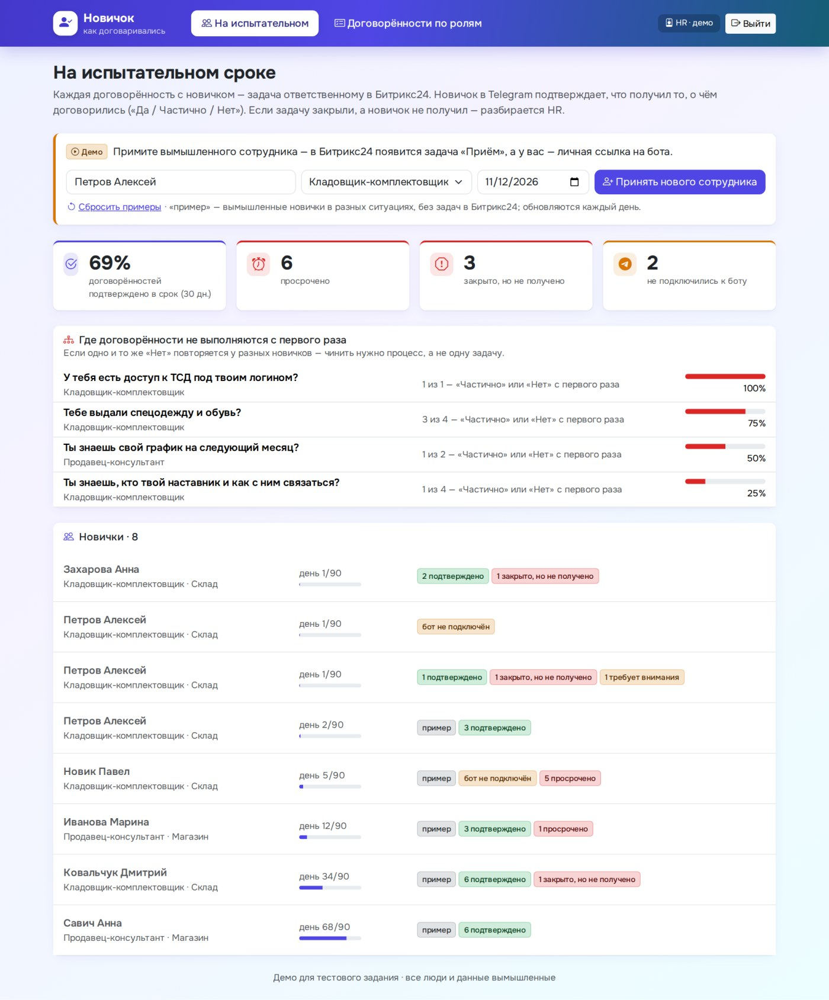
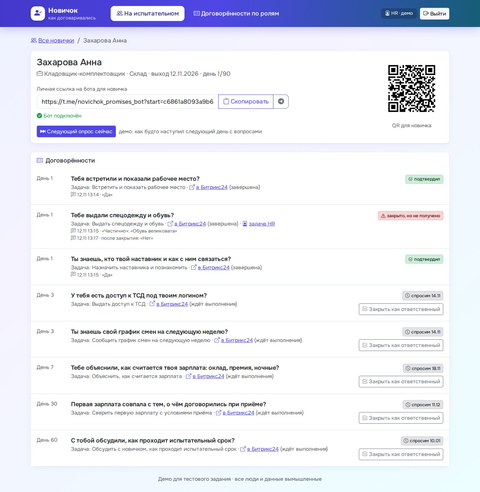
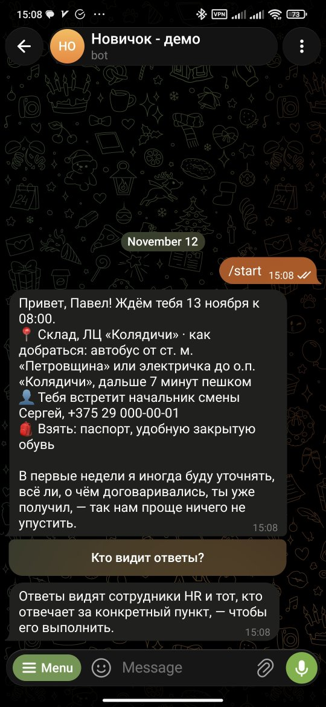
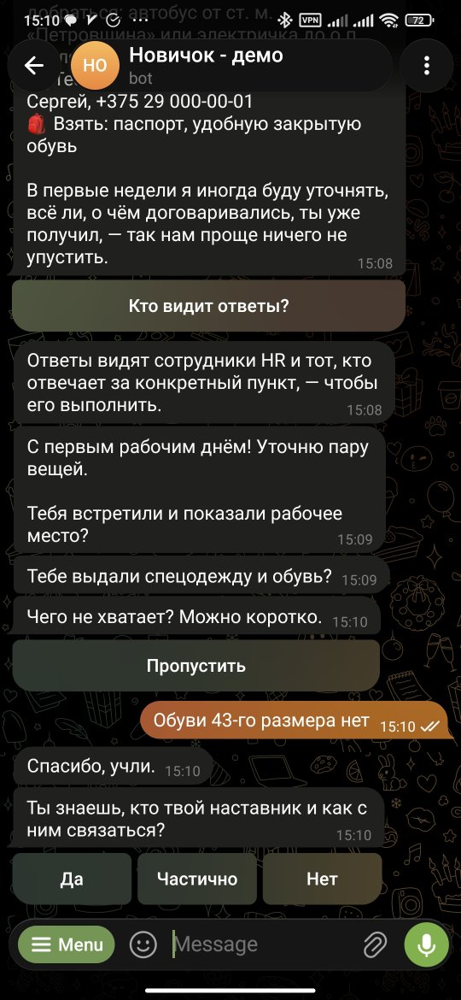
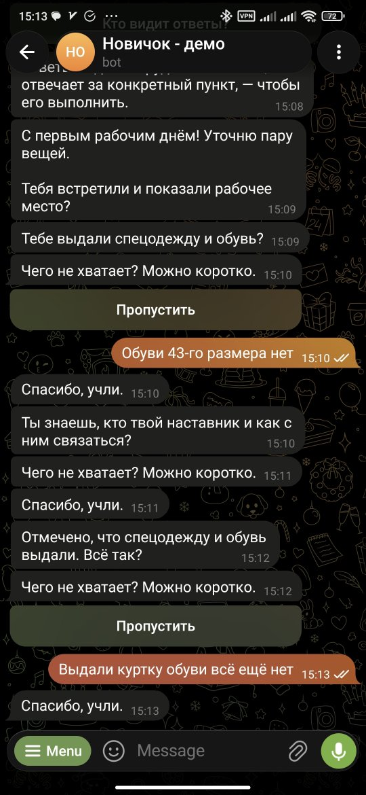
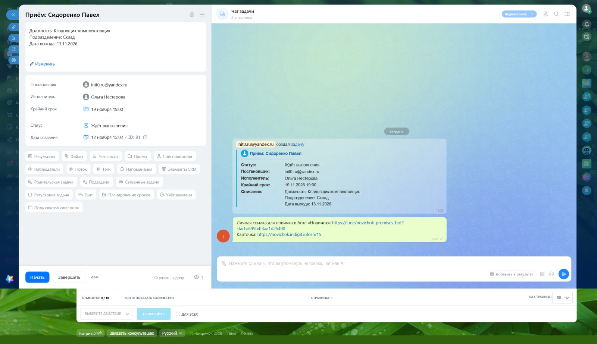
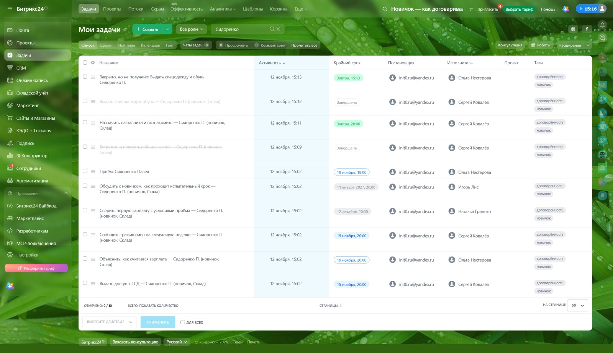
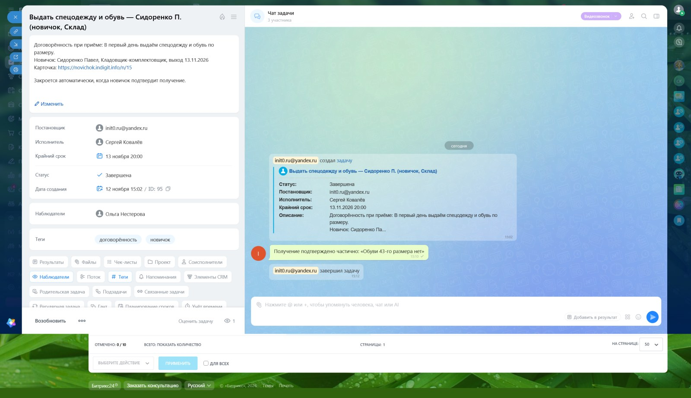
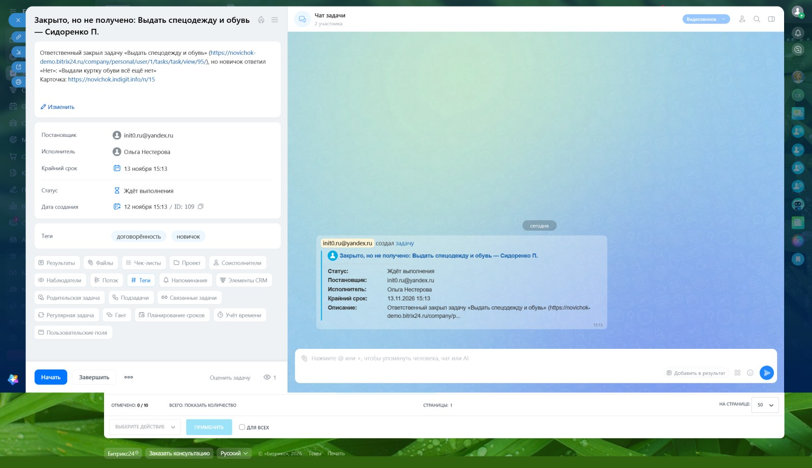
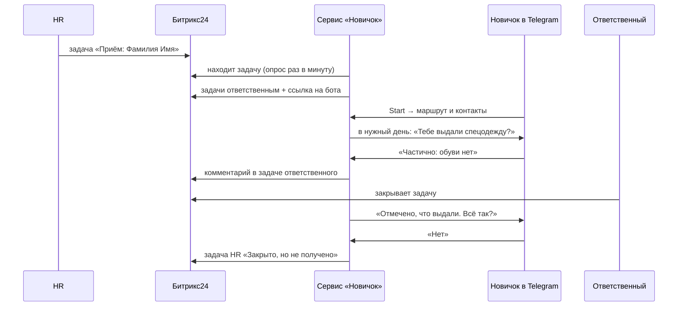

# Новичок · как договаривались

Каждая договорённость с новичком на испытательном сроке — задача ответственному в **Битрикс24**. Новичок подтверждает в Telegram, что получил то, о чём договорились; если задачу закрыли, а новичок не получил — разбирается HR.


**Демо:** [novichok.indigit.info](https://novichok.indigit.info) (пароль — в отчёте) · **бот:** [@novichok_promises_bot](https://t.me/novichok_promises_bot)

> [!NOTE]
> Тестовое задание для компании ТГТ, слово — «НОВИЧОК». Все люди и данные вымышленные; демо-портал Битрикс24 работает до 26.11.2026, после — панель переходит в режим просмотра.

## Содержание

- [Идея](#идея)
- [Построено на Битрикс24](#построено-на-битрикс24)
- [Как это выглядит](#как-это-выглядит)
- [Проверить за 2 минуты](#проверить-за-2-минуты)
- [Исследование](#исследование)
- [Как это работает](#как-это-работает)
- [Договорённости по ролям](#договорённости-по-ролям)
- [Стек и качество](#стек-и-качество)
- [Запуск](#запуск)
- [Подключение своего портала](#подключение-своего-портала)

## Идея

Каждый третий **из ушедших** (не каждый третий новичок) не доработал до трёх месяцев — то есть ушёл на испытательном сроке, пока уйти легко: 3 дня предупреждения вместо месяца (ТК РБ ст. 28–29, 40). Главная причина ранних уходов — работа оказалась не такой, как описывали при найме, и новичку не помогли освоиться.

Решение спрашивает новичка не о настроении, а о **действиях компании**: встретили ли, выдали ли спецодежду, знаешь ли наставника, совпала ли первая зарплата с условиями. Ответ «нет» здесь безопасно дать под своим именем — он про компанию, а не про новичка и не жалоба на руководителя.

| Кто | Где работает | Что делает |
|---|---|---|
| **Новичок** | Telegram (аккаунт в Битрикс24 не нужен) | Получает маршрут и контакты перед выходом, подтверждает договорённости: «Да / Частично / Нет» |
| **Ответственные** — начальник смены, бухгалтерия, руководитель | Битрикс24 | Получают задачу на каждую договорённость с крайним сроком и закрывают её |
| **HR** | Битрикс24 + панель | Наблюдатель во всех задачах; получает задачу «Закрыто, но не получено», если ответственный закрыл, а новичок не получил |

> [!TIP]
> **Гипотеза.** Часть ранних уходов — невыполненные договорённости первых недель. Проверить пилотом на одном складе: доля «Нет» по каждой договорённости и сколько новичков дошли до 90-го дня — до и после.

## Построено на Битрикс24

Приём и увольнение в компании уже идут задачами в Битрикс24 — решение встраивается в этот процесс, а не заменяет его:

| Что в Битрикс24 | Как используется |
|---|---|
| Задача «Приём: Фамилия Имя» | Точка входа: приложение находит её и запускает адаптацию, в комментарий кладёт личную ссылку на бота |
| Задачи ответственным | По одной на договорённость: ответственный, HR — наблюдатель, крайний срок, теги `новичок`, `договорённость` |
| Комментарии в задаче | «Новичок подтвердил получение» или ответ новичка: «Получение подтверждено частично: «обуви 43-го размера нет»» |
| Закрытие задачи | «Да» закрывает задачу автоматически; закрытие ответственным запускает повторный вопрос новичку |
| Задача HR | «Закрыто, но не получено: …» — со ссылкой на закрытую задачу и ответом новичка |

<details>
<summary>Технические детали интеграции</summary>

- REST API через входящий вебхук: `tasks.task.add`, `tasks.task.complete`, `tasks.task.list`, `task.commentitem.add` (на новой карточке задачи комментарий попадает в чат задачи).
- У каждой задачи есть `XML_ID` (`novichok-agreement-N`, `novichok-dispute-N`): если ответ на создание задачи потерялся, при повторе задача находится, а не создаётся второй раз.
- Исходящие вебхуки на демо-тарифе недоступны, поэтому изменения забираются опросом раз в минуту.
- Если Битрикс24 недоступен (или закончился доступ к REST), бот продолжает работать, панель переходит в режим просмотра, несделанные изменения повторяются позже.
- Облачный Битрикс24 нестабильно отвечает на запросы из-за рубежа — поддерживается прокси (`BITRIX_PROXY`).

</details>

## Как это выглядит

**Панель HR** — кто на испытательном сроке, показатели, «где договорённости не выполняются с первого раза»; карточка новичка со ссылкой, QR-кодом и статусом каждой договорённости:

| Панель HR | Карточка новичка |
|---|---|
|  |  |

**Telegram** — приветствие с маршрутом и контактом того, кто встретит; вопросы с уточнением «Чего не хватает?»; повторный вопрос после закрытия задачи ответственным:

| Приветствие | Вопросы первого дня | Повторный вопрос |
|---|---|---|
|  |  |  |

**Битрикс24** — задача «Приём» со ссылкой для новичка, задачи ответственным, ответ новичка в задаче и задача HR:

| Задача «Приём» | Задачи ответственным |
|---|---|
|  |  |
| **Ответ новичка в задаче** | **Задача HR «Закрыто, но не получено»** |
|  |  |

## Проверить за 2 минуты

1. В панели нажмите **«Принять нового сотрудника»** — в Битрикс24 появится задача «Приём» и 8 задач ответственным, у вас откроется карточка с QR-кодом.
2. Отсканируйте QR-код (или откройте ссылку) и нажмите **Start** — бот расскажет, как добраться и кто встретит.
3. В карточке нажмите **«Следующий опрос сейчас»** и ответьте в Telegram: «Да» закроет задачу ответственного, «Частично» — бот спросит, чего не хватает, ответ уйдёт комментарием в задачу.
4. Нажмите **«Закрыть как ответственный»** у любой договорённости — бот переспросит «Отмечено, что… Всё так?». Ответ «Нет» создаст задачу HR «Закрыто, но не получено».
5. Вернитесь на главную: показатели, «где договорённости не выполняются с первого раза» и примеры новичков в разных ситуациях.

## Исследование

Перед разработкой — разбор задачи, компании и того, что работает в мире. Кратко:

<details>
<summary><b>«Три месяца» — это испытательный срок</b></summary>

Испытательный срок в Беларуси — до 3 месяцев; в это время любая сторона расторгает договор за 3 дня, после — работник предупреждает за месяц или связан контрактом. Если ничего не делать, испытательный срок считается пройденным: решение о новичке фактически принимается к 60–80-му дню.

</details>

<details>
<summary><b>Почему новички уходят рано</b></summary>

- Работа не такая, как описывали при найме: 56% уходивших (hh.ru и Dream Job, 2026), 67% по оценке работодателей (hh.ru, 2025).
- 50% белорусов: работодатель не сделал того, о чём договаривались при найме, или адаптации не было (rabota.by, 2026).
- 64% уходивших решили уйти в первый месяц, 23% — в первую неделю.
- У самой компании в публичных отзывах — тот же сюжет: новичка отпустили через неделю, не объяснив, сколько длится обучение.

</details>

<details>
<summary><b>Почему не опрос настроения</b></summary>

Под своим именем подчинённые оценивают руководителя мягче, а самая частая причина молчания — страх прослыть негативным. Анонимность при ~2 наймах в неделю не работает: по отделу и месяцу набирается 1–2 ответа. Вопросы о фактах, за которые отвечает компания, отвечать под своим именем безопасно — и они измеряют главную причину уходов.

</details>

<details>
<summary><b>Что работает в мире</b></summary>

- **Внимание руководителей.** Рандомизированный эксперимент в сети из 238 магазинов в Восточной Европе: письмо директора руководителям «сократите уходы» снизило их на 20–25%.
- **Замкнутый цикл.** Сервисы для складов и логистики (WorkStep, WorkHound) спрашивают новичка в фиксированные дни и превращают проблему в задачу, у которой есть ответственный.
- **Честное описание работы и ясность роли** снижают текучесть (мета-анализы Earnest et al. 2011, Bauer et al. 2007).
- **Первый день** важен: час про сильные стороны новичка в первый день снизил текучесть через 7 месяцев (Wipro).

</details>

<details>
<summary><b>От чего отказался</b></summary>

- **Чек-лист адаптации** — уже есть в Маркете Битрикс24, и он рассчитан на новичков с аккаунтом в Битрикс24, которого у склада обычно нет.
- **Анонимный опрос** — при малом числе наймов анонимности не будет.
- **AI и прогноз увольнений** — причины ушедших неизвестны, прогнозировать не на чем.

</details>

<details>
<summary><b>Источники</b></summary>

- ТК РБ, ст. 28–29, 40 — [pravo.by](https://pravo.by/document/?guid=3871&p0=hk9900296)
- hh.ru и Dream Job, 2026 — [finance.mail.ru](https://finance.mail.ru/article/issledovanie-pokazalo-skolko-rossiyan-uhodili-s-novoj-raboty-69217935/)
- hh.ru, опрос работодателей, 2025 — [sostav.ru](https://www.sostav.ru/publication/90-kandidatov-uspeshno-proshli-ispytatelnyj-srok-na-novoj-rabote-v-2025-godu-80168.html)
- rabota.by, 2026 — [devby.io](https://devby.io/news/pochti-dve-treti-rabotauschih-belarusov-hotyat-smenit-rabotu-v-2026)
- Friebel, Heinz, Zubanov, 2022 — [Management Science](https://pubsonline.informs.org/doi/10.1287/mnsc.2020.3905)
- Earnest, Allen, Landis, 2011 — [realistic job previews](https://wrap.warwick.ac.uk/57084/)
- Bauer et al., 2007 — [newcomer adjustment](https://works.bepress.com/talya_bauer/8)
- Cable, Gino, Staats (Wipro) — [HBS Working Knowledge](https://www.library.hbs.edu/working-knowledge/first-minutes-are-critical-in-new-employee-orientation)
- Antonioni, 1994 — [upward feedback](https://doi.org/10.1111/j.1744-6570.1994.tb01728.x); Milliken et al., 2003 — [employee silence](https://ideas.repec.org/a/bla/jomstd/v40y2003i6p1453-1476.html)
- WorkStep — [milestone surveys](https://employers.workstep.com/article/b07plxfbz6-ra-milestone-surveys); WorkHound — [FreightWaves](https://www.freightwaves.com/news/drivers-tell-workhound-onboarding-goes-a-long-way-in-retention)
- Маркет Битрикс24: [Aventra](https://www.bitrix24.ru/apps/app/aventra.onbording_i_adaptatsiya_sotrudnikov/), [HRM: Онбординг](https://www.bitrix24.ru/apps/app/dbogdanoff.hrm_onbording/)

</details>

## Как это работает



- Вопросы приходят по одному, в день, когда договорённость уже должна быть выполнена.
- Бот не пишет раньше чем за 2 часа до начала и позже чем через 2 часа после конца рабочего дня роли.
- Без ответа — одно напоминание на следующий день, через 48 часов — «нет ответа».
- После ответа под вопросом остаётся «Твой ответ: …» — история в чате читается.

## Договорённости по ролям

Списки пишет HR вместе с руководителями, хранятся в [`config/roles.php`](config/roles.php). В демо — кладовщик-комплектовщик (8 договорённостей) и продавец-консультант (6).

> [!IMPORTANT]
> **Как писать вопрос новичку**
> 1. О действии компании, а не о новичке: «Тебе выдали спецодежду?», а не «Тебе нравится коллектив?».
> 2. Ответ «Нет» должен быть безопасным — не жалоба на человека и не признание слабости.
> 3. Проверяемо и исправимо примерно за сутки.
> 4. Только то, о чём компания действительно договаривается.
> 5. Один вопрос — одна договорённость, в день, когда она уже должна быть выполнена.

## Стек и качество

**PHP 8.4 · SQLite · Nutgram · Bootstrap 5 + webpack 5**

| Проверка | Инструмент | Команда |
|---|---|---|
| Тесты | PHPUnit — 123 теста, бот через fake Telegram API, Битрикс24 через fake-шлюз | `composer test` |
| Статический анализ | PHPStan, уровень 8 | `composer stan` |
| Фронтенд | ESLint (с проверкой устаревших API), Stylelint, Prettier | `npm run lint` |

<details>
<summary>Структура кода</summary>

```
src/Domain    состояния договорённости и переходы
src/Bitrix    REST-клиент и задачи Битрикс24
src/Hire      задача «Приём» → новичок и задачи ответственным
src/Bot       бот: тексты, разговор, обработка ответов
src/Sync      cron: опрос Битрикс24 и отправка вопросов по расписанию
src/Web       панель HR
src/Demo      демо-действия и примеры
templates     страницы панели
assets        стили и скрипты для webpack
config        договорённости по ролям и ответственные
```

</details>

## Запуск

```bash
composer install
npm ci && npm run build   # стили, скрипты, иконки и шрифт → public/build
cp .env.example ../.env   # секреты лежат вне репозитория
composer check && npm run lint
```

<details>
<summary>Переменные окружения, веб-сервер и cron</summary>

`../.env`: `BITRIX_WEBHOOK_URL`, `BITRIX_PROXY` (необязательно), `TELEGRAM_BOT_TOKEN`, `TELEGRAM_BOT_USERNAME`, `TELEGRAM_WEBHOOK_PATH`, `TELEGRAM_WEBHOOK_SECRET`, `PANEL_PASSWORD`, `APP_URL`, `DEMO` (1 — включить демо-панель), `DB_PATH` (необязательно).

- Панель: корень сайта — `public/`, PHP-FPM.
- Telegram: `webhook/telegram.php` на отдельном пути с HTTPS, затем `php bin/set-webhook.php` (проверка секретного заголовка, только `message` и `callback_query`).
- Cron:

```
* * * * * cd /path/to/repo && flock -n var/tick.lock php bin/tick.php
0 3 * * * cd /path/to/repo && php bin/reset-examples.php
```

</details>

## Подключение своего портала

1. Входящий вебхук с правами `task`, `user`, `department` (на облачных тарифах нужен доступ к REST API).
2. ID ответственных — в [`config/portal.php`](config/portal.php), договорённости — в [`config/roles.php`](config/roles.php).
3. Формат задачи «Приём» здесь придуман для демо; разбор вынесен в [`src/Hire/HireTaskParser.php`](src/Hire/HireTaskParser.php) и меняется под ваш формат.
